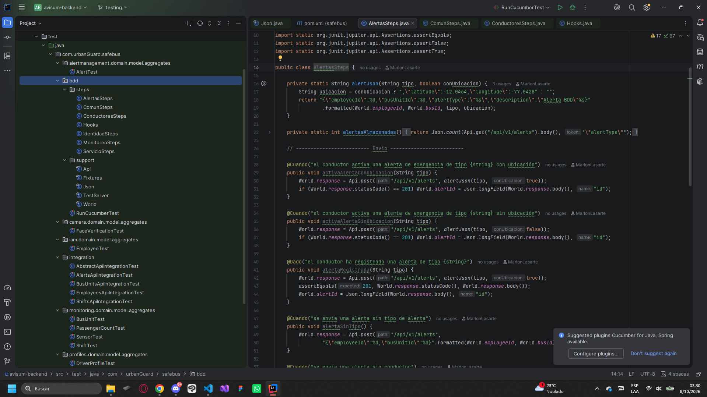

# Capítulo VII: DevOps Practices
## 7.1. Continuous Integration
### 7.1.1. Tools and Practices.
En el desarrollo y las pruebas de software, es fundamental utilizar herramientas y metodologías que permitan garantizar la calidad del código y mejorar la productividad del equipo. Para ello, se emplearon diversas herramientas orientadas tanto a la implementación como a la validación del funcionamiento y comportamiento esperado de la aplicación. Estas abarcan diferentes etapas del ciclo de vida del software, desde la programación y gestión del código hasta la ejecución de pruebas y la automatización de procesos.

Se aplicaron las metodologías de Desarrollo Orientado por Comportamiento (BDD) y Desarrollo Orientado por Pruebas (TDD), con el propósito de garantizar que las soluciones desarrolladas cumplan con los requerimientos establecidos y mantengan un adecuado nivel de calidad técnica. Para ello, se utilizaron diversas herramientas que facilitaron tanto el desarrollo como la validación del software. Entre las principales se encuentran:

|Herramienta|Tipo|Descripción|Propósito|
| :--: | :--: | :--: | :--:|
|J Unit| Herramienta para puebas (TDD)| Es un programa que ayuda a probar pequeñas partes de aplicaciones en Java| Hace más facil crear y ejecutar pruebas para asegurarse de que las funciones de los componentes funcionen como deberían.|
|Cucumber|Herramienta de BDD| Ayuda a desarrollar programas centrándose ene l comportamiento usando Gherkin para escribir ejemplos que todos entiendan.| Crea y prueba ejemplos basados en cómo debería comportarse el sistema, asegurando que el desarrollo esté alineado con lo que necesita el negocio|

### 7.1.2. Build & Test Suite Pipeline Components.

## 7.2. Continuos Delivery
### 7.2.1. Tools and Practices.
Su objetivo es automatizar la integración y ejecución de pruebas del código, asegurando que el proyecto se mantenga preparado para realizar un despliegue cuando sea necesario.

**Tools:**

**GitHub Actions / GitLab CLI:** Permiten automatizar el pipeline de CI/CD y configurar diferentes etapas de validación. En Continuous Delivery, el pipeline puede preparar y validar el software para su despliegue, dejando la publicación en producción sujeta a una aprobación manual.

**Jira:** Se utiliza para organizar y gestionar el proceso de aprobación del despliegue. Después de completar las validaciones del pipeline, el responsable del proyecto puede revisar los resultados y autorizar el paso a producción.

**Docker:** Permite contenerizar la aplicación y mantener entornos consistentes entre desarrollo, pruebas y producción. También facilita la validación de la aplicación en ambientes intermedios, como staging.

**Practices (Prácticas):**

**Feature Branching y Merge Requests:** Las nuevas funcionalidades y modificaciones se desarrollan en ramas independientes. Una vez superadas las pruebas y revisiones correspondientes, los cambios se integran en una rama estable, mientras que el despliegue a producción puede requerir una aprobación manual.

**Pipeline de Validación en Staging:** Antes del despliegue a producción, los cambios pasan por un entorno de staging que reproduce condiciones similares a las del entorno final. Esto permite realizar pruebas adicionales y verificar el correcto funcionamiento de la aplicación.

**Despliegue Semiautomático:** El pipeline automatiza la preparación y validación de la aplicación, pero el despliegue final a producción se ejecuta únicamente después de recibir la aprobación de un responsable.

**Aprobación Manual:** Antes de publicar una nueva versión, un responsable revisa los resultados obtenidos durante las pruebas y autoriza el despliegue. Esta práctica permite reducir el riesgo de introducir cambios no deseados en producción.

**Rollback Manual:** En caso de detectar problemas después de un despliegue, el equipo puede revertir manualmente la aplicación a una versión estable anterior. Esto permite controlar el proceso de recuperación y minimizar el impacto de posibles errores.

### 7.2.2. Stages Deployment Pipeline Components.

**Integración Continua (CI):** Cuando se realiza un commit en una rama de desarrollo, el pipeline ejecuta pruebas automatizadas y valida que la aplicación cumpla con las condiciones necesarias para su despliegue. Esto permite mantener el código en un estado estable y preparado para avanzar a las siguientes etapas.

**Validación en Staging:** Antes de llegar a producción, el código se despliega en un entorno de staging donde se simulan condiciones similares a las del entorno final. En esta etapa pueden realizarse pruebas adicionales, como pruebas manuales, de carga y de seguridad.

**Despliegue Manual:** Aunque la aplicación se encuentre completamente preparada, el despliegue hacia producción requiere la aprobación de una persona responsable. Esto permite realizar una última revisión antes de poner los cambios a disposición de los usuarios.

**Monitoreo y Feedback:** El pipeline incorpora mecanismos de monitoreo y análisis que permiten evaluar el comportamiento y rendimiento de la aplicación durante las etapas previas al despliegue definitivo. La información obtenida facilita la identificación de posibles problemas y la toma de decisiones.

**Aprobación del Despliegue:** El pipeline permanece en espera hasta que un desarrollador, administrador o responsable de operaciones revise los resultados de las validaciones y autorice el despliegue a producción.

## 7.3. Continuos deployment. 
El objetivo del Continuous Deployment (CD) es automatizar el proceso de despliegue de los cambios aprobados, llevando cada nueva versión desde el entorno de desarrollo hasta producción sin intervención manual, siempre que supere satisfactoriamente todas las pruebas y validaciones establecidas.

### 7.3.1. Tools and Practices.
En este apartado se presentan las herramientas y prácticas utilizadas para garantizar un proceso de despliegue automatizado, estable y confiable en el entorno de producción.

**Tools (Herramientas):**

* **GitHub Actions / GitLab CI:** Permiten automatizar el pipeline de CI/CD mediante workflows que ejecutan pruebas, construyen la aplicación y gestionan su despliegue en los diferentes entornos, como desarrollo, staging y producción.

* **Docker:** Se utiliza para contenerizar la aplicación backend desarrollada con Spring Boot, incluyendo sus dependencias y configuración. Esto permite mantener mayor consistencia entre los diferentes entornos de ejecución.

* **Render:** Se emplea para realizar el despliegue del backend desarrollado con Spring Boot (contenedor Docker), junto con su base de datos H2 embebida (en modo compatible con MySQL), permitiendo automatizar la publicación de nuevas versiones y facilitar el monitoreo de la aplicación.

* **Vercel:** Se utiliza para alojar y desplegar tanto el Landing Page como el Frontend-Web desarrollado con Angular, automatizando la publicación en cada push a la rama correspondiente y proporcionando un proceso de despliegue rápido, con URLs de preview por cada deploy.

**Practices (Prácticas):**

* **Feature Branching:** Se utiliza una estrategia de ramas en Git donde cada nueva funcionalidad o modificación se desarrolla de manera independiente. Una vez completada y validada, la rama se integra con la rama `develop`, permitiendo mantener un flujo de trabajo organizado.

* **Commit-based Deployment (Despliegue basado en commits):** Cada vez que se realiza un commit en la rama `develop`, el pipeline de CI/CD se activa automáticamente para ejecutar las etapas de construcción, pruebas y despliegue. Esto permite mantener un flujo de trabajo continuo y automatizado.

* **Rollback Automático:** En caso de detectar errores durante o después del despliegue en producción, el proceso puede restaurar una versión estable anterior de la aplicación. Esto permite reducir el impacto de los fallos y facilitar una recuperación rápida del servicio.

### 7.3.2. Production Deployment Pipeline Components.

Este apartado describe los principales componentes que conforman el pipeline de despliegue a producción y la manera en que se integran para automatizar el proceso.

**Componentes del Pipeline del Backend y Base de Datos (Render para Spring Boot):**

El backend y su base de datos se despliegan juntos en Render: la base de datos es una instancia H2 (en modo compatible con MySQL) embebida dentro del mismo contenedor del backend, por lo que no requiere un proveedor de base de datos independiente.

1. **Integración Continua:** Cuando se realiza un commit en la rama `develop`, Render obtiene la versión actualizada del backend desarrollado con Spring Boot y ejecuta el proceso de construcción mediante Maven.

2. **Construcción de la Imagen Docker:** Se genera una imagen Docker que contiene la aplicación, la configuración de la base de datos H2 y sus dependencias necesarias para ejecutarse correctamente en el entorno de producción.

3. **Despliegue:** Una vez finalizada la construcción, Render implementa la nueva versión del backend (junto con su base de datos) en el entorno de producción.

4. **Monitoreo y Alertas:** Después del despliegue, se supervisa el funcionamiento de la aplicación y de la base de datos para detectar posibles errores o problemas de rendimiento que puedan requerir la intervención del equipo.

**Componentes del Pipeline del Frontend (Vercel para Angular):**

1. **Compilación del Frontend:** Al detectar una nueva versión del código, se ejecuta el proceso de compilación de la aplicación Angular en modo producción, generando los archivos necesarios para su publicación.

2. **Ejecución de Pruebas Automatizadas:** Se ejecutan pruebas unitarias y pruebas End-to-End (E2E) para verificar que las principales funcionalidades de la interfaz funcionen correctamente.

3. **Despliegue en Vercel:** Si las validaciones se completan satisfactoriamente, la nueva versión de la aplicación (Landing Page y Frontend-Web) se publica automáticamente mediante Vercel, permitiendo su distribución a los usuarios y generando una URL de preview por cada deploy.

4. **Invalidación de Caché / CDN:** Vercel actualiza automáticamente la caché de su red de edge (CDN) para garantizar que los usuarios puedan acceder a la versión más reciente de la aplicación después del despliegue.

---

## 7.4. Continuous Monitoring

### 7.4.1. Tools and Practices

| Herramienta | Uso en Avisum |
|---|---|
| UptimeRobot (plan gratuito) | Monitoreo externo HTTP(S) de la disponibilidad del backend |
| Correo electrónico | Canal de notificación de incidentes |
| Discord (webhook) | Canal de notificación del equipo |
| Swagger UI del backend (Render) | Endpoint verificado en cada chequeo |

**Prácticas aplicadas:**

- Monitoreo externo continuo cada 5 minutos.
- Alertas automáticas ante caída y recuperación del servicio.
- Historial de incidentes y tiempos de respuesta.
- Validación del flujo mediante una caída simulada.

**Mejoras futuras:** Spring Boot Actuator (`/actuator/health`), Sentry y métricas de latencia y memoria.

---

### 7.4.2. Monitoring Pipeline Components

El pipeline de monitoreo tiene tres componentes:

- **Sonda:** un monitor HTTP/S de UptimeRobot consulta `https://avisum-backend.onrender.com/swagger-ui.html` cada 5 minutos desde una ubicación automática (Falkenstein, Alemania).
- **Evaluación:** el servicio se considera disponible (*Up*) si responde con éxito y caído (*Down*) si devuelve un error o no responde.
- **Visualización:** el panel de UptimeRobot muestra el estado actual, la disponibilidad en 24 horas, 7 y 30 días, el tiempo de respuesta (alrededor de 450 a 550 ms) y el historial de incidentes.

  

---

### 7.4.3. Alerting Pipeline Components

**Regla de alerta:** si una verificación recibe un código distinto de éxito o no hay respuesta, se abre un incidente y se dispara la alerta. Cuando el servicio vuelve a responder, se cierra el incidente y se envía la alerta de recuperación. La regla se configuró sin retraso ni repetición.

**Prueba de validación:** se cambió la URL monitoreada a una ruta inexistente (`swagger-ui.htmlXX`).

| Dato | Valor |
|---|---|
| Causa raíz | HTTP 404 – Not Found |
| Inicio del incidente | 08/11/2026 18:28:11 |
| Resolución | 08/11/2026 18:30:47 |
| Duración | 2 min 36 s |

  

  

  

  

---

### 7.4.4. Notification Pipeline Components

Las alertas se envían por dos canales: **correo electrónico** del equipo y un canal de **Discord** conectado mediante webhook. Cada notificación incluye:

- el monitor y la URL verificada,
- la causa raíz,
- la ubicación de la sonda,
- la hora de inicio y de resolución,
- la duración del incidente.

| Evento | Hora | Canales |
|---|---|---|
| Prueba de correo | 18:13 | Correo |
| Confirmación del webhook | 18:23 | Discord |
| Alerta **Down** | 18:28 | Correo y Discord |
| Alerta **Up** (recuperación) | 18:30 | Correo y Discord |

**Alerta de caída (Down)**

  

  

**Alerta de recuperación (Up)**

  

  

