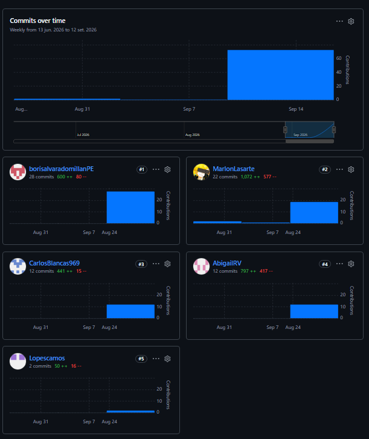
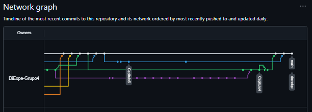
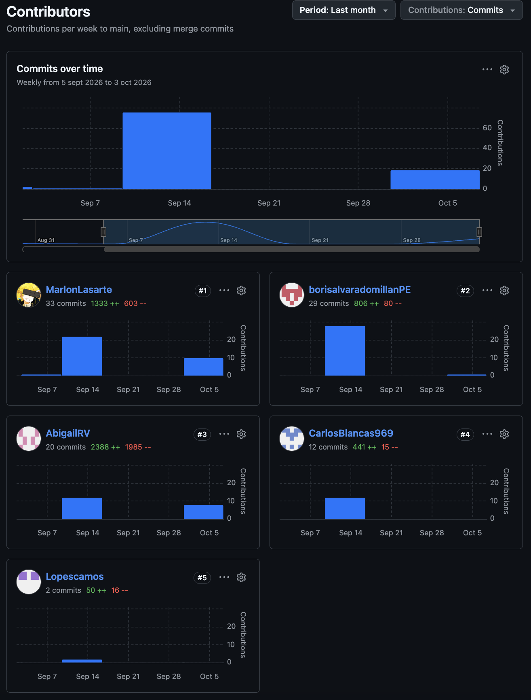
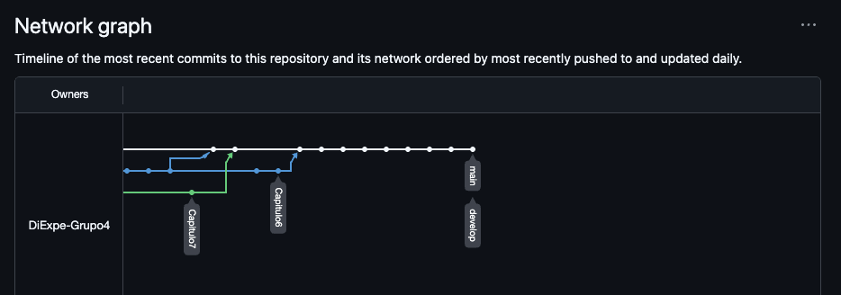

  
  
  <h1>Universidad Peruana de Ciencias Aplicadas</h1>
  <h2 >Carrera de Ingeniería de Software</h2>
   
  <h2>1ASI0732</h2>
  <h2>Diseño de Experimentos de Ingenería de Software</h2>
  <h2 >Sección: 2620</h2>
  <h2 >NRC: 9097</h2>
   
  <h2 >Startup: UrbanGuard</h2>
  <h2 >Producto: Avisum</h2>
   
  <h3 >Integrantes:</h3>

| Código | Nombre |
| :---: | :---: |
|U20241A995|Ivonne Beatriz Ibañez Torres|
|U20241A322|Carlos Franco Blancas Chavez|
|U20241D958|Kevin Edu Lopez Montalvo|
|U20241B676|Boris Alvarado Millan|
|U202318001|Nadhim Abigail Raymundo Villarroel|

   
  <h2 >Periodo 2026-2</h2>
  <h3>Agosto del 2026</h3>

---

## Registro de Versiones del Informe

| Versión | Fecha | Autor | Descripción de modificación |
|:---:|:---:|:---:|:---:|
| 0.1 | 24/08/2026 |Ivonne Ibañez Carlos Blancas Kevin Lopez Boris Alvarado  Abigail Raymundo |**Agregación de:**   Carátula Registro de Versiones del Informe Contenido Student Outcome Capítulo I: Introducción 1.1. Startup Profile 1.1.1. Descripción de la Startup 1.1.2. Perfiles de integrantes del equipo 1.2. Solution Profile 1.2.1. Antecedentes y problemática 1.2.2. Lean UX Process. 1.2.2.1. Lean UX Problem Statements. 1.2.2.2. Lean UX Assumptions. 1.2.2.3. Lean UX Hypothesis Statements. 1.2.2.4. Lean UX Canvas. 1.3. Segmentos objetivo. Capítulo II: Requirements Elicitation & Analysis 2.1. Competidores. 2.1.1. Análisis competitivo. 2.1.2. Estrategias y tácticas frente a competidores. 2.2. Entrevistas. 2.2.1. Diseño de entrevistas. 2.2.2. Registro de entrevistas. 2.2.3. Análisis de entrevistas. 2.3. Needfinding. 2.3.1. User Personas. 2.3.2. User Task Matrix. 2.3.3. User Journey Mapping. 2.3.4. Empathy Mapping. 2.3.5. As-is Scenario Mapping. 2.4. Ubiquitous Language. Capítulo III: Requirements Specification 3.1. To-Be Scenario Mapping. 3.2. User Stories. 3.3. Product Backlog. 3.4. Impact Mapping. Capítulo IV: Product Design 4.1. Style Guidelines. 4.1.1. General Style Guidelines. 4.1.2. Web Style Guidelines. 4.1.3. Mobile Style Guidelines. 4.1.3.1. iOS Mobile Style Guidelines. 4.1.3.2. Android Mobile Style Guidelines. 4.2. Information Architecture. 4.2.1. Organization Systems. 4.2.2. Labeling Systems. 4.2.3. SEO Tags and Meta Tags 4.2.4. Searching Systems. 4.2.5. Navigation Systems. 4.3. Landing Page UI Design. 4.3.1. Landing Page Wireframe. 4.3.2. Landing Page Mock-up. 4.4. Mobile Applications UX/UI Design. 4.4.1. Mobile Applications Wireframes. 4.4.2. Mobile Applications Wireflow Diagrams. 4.4.3. Mobile Applications Mock-ups. 4.4.4. Mobile Applications User Flow Diagrams. 4.5. Mobile Applications Prototyping. 4.5.1. Android Mobile Applications Prototyping. 4.5.2. iOS Mobile Applications Prototyping. 4.6. Web Applications UX/UI Design. 4.6.1. Web Applications Wireframes. 4.6.2. Web Applications Wireflow Diagrams. 4.6.3. Web Applications Mock-ups. 4.6.4. Web Applications User Flow Diagrams. 4.7. Web Applications Prototyping. 4.8. Domain-Driven Software Architecture. 4.8.1. Software Architecture Context Diagram. 4.8.2. Software Architecture Container Diagrams. 4.8.3. Software Architecture Components Diagrams. 4.9. Software Object-Oriented Design. 4.9.1. Class Diagrams. 4.9.2. Class Dictionary. 4.10. Database Design. 4.10.1. Relational/Non-Relational Database Diagram. Capítulo V: Product Implementation 5.1. Software Configuration Management. 5.1.1. Software Development Environment Configuration. 5.1.2. Source Code Management. 5.1.3. Source Code Style Guide & Conventions. 5.1.4. Software Deployment Configuration. 5.2. Product Implementation & Deployment. 5.2.1. Sprint Backlogs. 5.2.2. Implemented Landing Page Evidence 5.2.3. Implemented Frontend-Web Application Evidence 5.2.4. Implemented Native-Mobile Application Evidence 5.2.5. Implemented RESTful API and/or Serverless Backend Evidence 5.2.6. RESTful API documentation 5.2.7. Team Collaboration Insights 5.3. Video About-the-Product. **Avance de:**  Conclusiones  Bibliografía   Anexos|
| 0.2 | 24/09/2026 |Ivonne Ibañez Carlos Blancas Kevin Lopez Boris Alvarado  Abigail Raymundo | **Agregación de:**   Capítulo VI: Product Verification & Validation 6.1. Testing Suites & Validation 6.1.1. Core Entities Unit Tests. 6.1.2. Core Integration Tests. 6.1.3. Core Behavior-Driven Development 6.1.4. Core System Tests. Capítulo VII: DevOps Practices 7.1. Continuous Integration  7.1.1. Tools and Practices. 7.1.2. Build & Test Suite Pipeline Components. 7.2. Continuous Delivery 7.2.1. Tools and Practices. 7.2.2. Stages Deployment Pipeline Components. 7.3. Continuous deployment 7.3.1. Tools and Practices. 7.3.2. Production Deployment Pipeline Components  **Actualización de:**  Conclusiones  Bibliografía   Anexos |
| 0.3 | 08/10/2026 | Ivonne Ibañez Carlos Blancas Kevin Lopez Boris Alvarado  Abigail Raymundo | **Agregación de:**   Capítulo III: Requirements Specification 3.1. To-Be Scenario Mapping. 3.2. User Stories. 3.3. Product Backlog. 3.4. Impact Mapping. 5.2.4. Acuerdo de Servicio - SaaS 5.2.5. Implemented Native-Mobile Application Evidence 5.3. Video About-the-Product (estructura, pendiente de video) Anexo A. Videos de Exposiciones Evidencia de 6.1.4. Core System Tests (capturas ST-01 a ST-12) **Corrección de:** Párrafo introductorio de 3.1. To-Be Scenario Mapping (comparación con As-Is) Numeración del índice de la sección 5.2 (inserción de 5.2.4. Acuerdo de Servicio - SaaS) Criterio específico del Student Outcome (4.c.2, antes referido como 5.c.2) |
| 0.4 | 08/11/2026 | Ivonne Ibañez Carlos Blancas Kevin Lopez Boris Alvarado  Abigail Raymundo | **Agregación de:**   Capítulo VI: Product Verification & Validation 6.2. Static testing & Verification 6.2.1. Static Code Analysis 6.2.1.1. Coding standard & Code conventions. 6.2.1.2. Code Quality & Code Security. 6.2.2. Reviews 6.3. Validation Interviews. 6.3.1. Diseño de Entrevistas. 6.3.2. Registro de Entrevistas. 6.3.3. Evaluaciones según heurísticas. 6.4. Auditoría de Experiencias de Usuario. 6.4.1. Auditoría realizada. 6.4.1.1. Información del grupo auditado. 6.4.1.2. Cronograma de auditoría realizada. 6.4.1.3. Contenido de auditoría realizada. 6.4.2. Auditoría recibida. 6.4.2.1. Información del grupo auditor. 6.4.2.2. Cronograma de auditoría recibida. 6.4.2.3. Contenido de auditoría recibida. 6.4.2.4. Resumen de modificaciones para subsanar hallazgos. Capítulo VII: DevOps Practices 7.4. Continuous Monitoring 7.4.1. Tools and Practices 7.4.2. Monitoring Pipeline Components 7.4.3. Alerting Pipeline Components 7.4.4. Notification Pipeline Components. Capítulo VIII: Experiment-Driven Development 8.1. Experiment Planning 8.1.1. As-Is Summary. 8.1.2. Raw Material: Assumptions, Knowledge Gaps, Ideas, Claims. 8.1.3. Experiment-Ready Questions. 8.1.4. Question Backlog. 8.1.5. Experiment Cards. 8.2. Experiment Design 8.2.1. Hypotheses. 8.2.2. Domain Business Metrics 8.2.3. Measures. 8.2.4. Conditions. 8.2.5. Scale Calculations and Decisions. 8.2.6. Methods Selection. 8.2.7. Data Analytics: Goals, KPIs and Metrics Selection. 8.2.8. Web and Mobile Tracking Plan. 8.3. Experimentation 8.3.1. To-Be User Stories. 8.3.2. To-Be Product Backlog **Actualización de:**  Conclusiones  Bibliografía   Anexos |

---

## Project Report Collaboration Insights

En esta sección se indica el URL del repositorio utilizado para la elaboración colaborativa del Informe de Trabajo Final, así como las evidencias de participación de cada integrante del equipo durante el desarrollo de las entregas.

| URL de la organización del proyecto | URL del repositorio del reporte |
|:---:|:---:|
| https://github.com/orgs/DiExpe-Grupo4/repositories | https://github.com/DiExpe-Grupo4/report |

###  Primer Hito: AVANCE 1 - Sprint Review

Durante el desarrollo de la entrega AV1, el equipo distribuyó la elaboración del informe asignando capítulos y secciones específicas a cada integrante según sus áreas de responsabilidad. Cada miembro realizó sus aportes directamente en el repositorio de GitHub mediante commits en ramas individuales por capitulo, siguiendo la convención de Conventional Commits, y luego integrando los cambios mediante Pull Requests hacia la rama develop y después pasando todo a la rama main. Todos los integrantes participaron activamente en la redacción de secciones del informe, asegurando coherencia y calidad en el contenido entregado.

Se presenta la evidencia de trabajo segun los Insights de Github.

### Segundo Hito: TRABAJO PARCIAL  – Stage Review

Durante el desarrollo de la entrega de la TP1, el equipo distribuyó la elaboración del informe asignando capítulos y secciones específicas a cada integrante según sus áreas de responsabilidad. Cada miembro realizó sus aportes directamente en el repositorio de GitHub mediante commits en ramas individuales, siguiendo la convención de Conventional Commits, y luego integrando los cambios mediante Pull Requests hacia la rama develop y después pasando todo a la rama main. Todos los integrantes participaron activamente en la redacción de secciones del informe, asegurando coherencia y calidad en el contenido entregado

Se presenta la evidencia de trabajo segun los Insights de Github.

### Tercer Hito: AVANCE 2 – Sprint Review

Durante el desarrollo de la entrega AV2, el equipo continuó con la elaboración colaborativa del informe, distribuyendo las secciones pendientes de los capítulos VI, VII y VIII entre los integrantes según sus áreas de responsabilidad. Cada miembro realizó sus aportes directamente en el repositorio de GitHub mediante commits en ramas individuales, siguiendo la convención de Conventional Commits, y luego integrando los cambios mediante Pull Requests hacia la rama develop y después pasando todo a la rama main. Todos los integrantes participaron activamente en la redacción, revisión y corrección de secciones del informe, asegurando coherencia y calidad en el contenido entregado.

Se presenta la evidencia de trabajo según los Insights de GitHub.

---

# Indice

<!--falta actualizar los indices, recomeindo hacerlo al final -ivn -->

- [Carátula](#carátula)
- [Registro de Versiones del Informe](#registro-de-versiones-del-informe)
- [Contenido](#contenido)
- [Student Outcome](#student-outcome)

- [Capítulo I: Introducción](#cap1)
    - [1.1. Startup Profile](#11-startup-profile)
        - [1.1.1. Descripción de la Startup](#111-descripción-de-la-startup)
        - [1.1.2. Perfiles de integrantes del equipo](#112-perfiles-de-integrantes-del-equipo)
    - [1.2. Solution Profile](#12-solution-profile)
        - [1.2.1. Antecedentes y problemática](#121-antecedentes-y-problemática)
        - [1.2.2. Lean UX Process](#122-lean-ux-process)
            - [1.2.2.1. Lean UX Problem Statements](#1221-lean-ux-problem-statements)
            - [1.2.2.2. Lean UX Assumptions](#1222-lean-ux-assumptions)
            - [1.2.2.3. Lean UX Hypothesis Statements](#1223-lean-ux-hypothesis-statements)
            - [1.2.2.4. Lean UX Canvas](#1224-lean-ux-canvas)
    - [1.3. Segmentos objetivo](#13-segmentos-objetivo)

- [Capítulo II: Requirements Elicitation & Analysis](#cap2)
    - [2.1. Competidores](#21-competidores)
        - [2.1.1. Análisis competitivo](#211-análisis-competitivo)
        - [2.1.2. Estrategias y tácticas frente a competidores](#212-estrategias-y-tácticas-frente-a-competidores)
    - [2.2. Entrevistas](#22-entrevistas)
        - [2.2.1. Diseño de entrevistas](#221-diseño-de-entrevistas)
        - [2.2.2. Registro de entrevistas](#222-registro-de-entrevistas)
        - [2.2.3. Análisis de entrevistas](#223-análisis-de-entrevistas)
    - [2.3. Needfinding](#23-needfinding)
        - [2.3.1. User Personas](#231-user-personas)
        - [2.3.2. User Task Matrix](#232-user-task-matrix)
        - [2.3.3. User Journey Mapping](#233-user-journey-mapping)
        - [2.3.4. Empathy Mapping](#234-empathy-mapping)
        - [2.3.5. As-is Scenario Mapping](#235-as-is-scenario-mapping)
    - [2.4. Ubiquitous Language](#24-ubiquitous-language)

- [Capítulo III: Requirements Specification](#cap3)
    - [3.1. To-Be Scenario Mapping](#31-to-be-scenario-mapping)
    - [3.2. User Stories](#32-user-stories)
    - [3.3. Product Backlog](#33-product-backlog)
    - [3.4. Impact Mapping](#34-impact-mapping)
- [Avance de Conclusiones, Bibliografía y Anexos](#avance-de-conclusiones-bibliografía-y-anexos)

- [Capítulo IV: Product Design](#cap4)
    - [4.1. Style Guidelines](#41-style-guidelines)
        - [4.1.1. General Style Guidelines](#411-general-style-guidelines)
        - [4.1.2. Web Style Guidelines](#412-web-style-guidelines)
        - [4.1.3. Mobile Style Guidelines](#413-mobile-style-guidelines)
            - [4.1.3.1. iOS Mobile Style Guidelines](#4131-ios-mobile-style-guidelines)
            - [4.1.3.2. Android Mobile Style Guidelines](#4132-android-mobile-style-guidelines)
    - [4.2. Information Architecture](#42-information-architecture)
        - [4.2.1. Organization Systems](#421-organization-systems)
        - [4.2.2. Labeling Systems](#422-labeling-systems)
        - [4.2.3. SEO Tags and Meta Tags](#423-seo-tags-and-meta-tags)
        - [4.2.4. Searching Systems](#424-searching-systems)
        - [4.2.5. Navigation Systems](#425-navigation-systems)
    - [4.3. Landing Page UI Design](#43-landing-page-ui-design)
        - [4.3.1. Landing Page Wireframe](#431-landing-page-wireframe)
        - [4.3.2. Landing Page Mock-up](#432-landing-page-mock-up)
    - [4.4. Mobile Applications UX/UI Design](#44-mobile-applications-uxui-design)
        - [4.4.1. Mobile Applications Wireframes](#441-mobile-applications-wireframes)
        - [4.4.2. Mobile Applications Wireflow Diagrams](#442-mobile-applications-wireflow-diagrams)
        - [4.4.3. Mobile Applications Mock-ups](#443-mobile-applications-mock-ups)
        - [4.4.4. Mobile Applications User Flow Diagrams](#444-mobile-applications-user-flow-diagrams)
    - [4.5. Mobile Applications Prototyping](#45-mobile-applications-prototyping)
        - [4.5.1. Android Mobile Applications Prototyping](#451-android-mobile-applications-prototyping)
        - [4.5.2. iOS Mobile Applications Prototyping](#452-ios-mobile-applications-prototyping)
    - [4.6. Web Applications UX/UI Design](#46-web-applications-uxui-design)
        - [4.6.1. Web Applications Wireframes](#461-web-applications-wireframes)
        - [4.6.2. Web Applications Wireflow Diagrams](#462-web-applications-wireflow-diagrams)
        - [4.6.3. Web Applications Mock-ups](#463-web-applications-mock-ups)
        - [4.6.4. Web Applications User Flow Diagrams](#464-web-applications-user-flow-diagrams)
    - [4.7. Web Applications Prototyping](#47-web-applications-prototyping)
    - [4.8. Domain-Driven Software Architecture](#48-domain-driven-software-architecture)
        - [4.8.1. Software Architecture Context Diagram](#481-software-architecture-context-diagram)
        - [4.8.2. Software Architecture Container Diagrams](#482-software-architecture-container-diagrams)
        - [4.8.3. Software Architecture Components Diagrams](#483-software-architecture-components-diagrams)
    - [4.9. Software Object-Oriented Design](#49-software-object-oriented-design)
        - [4.9.1. Class Diagrams](#491-class-diagrams)
        - [4.9.2. Class Dictionary](#492-class-dictionary)
    - [4.10. Database Design](#410-database-design)
        - [4.10.1. Relational/Non-Relational Database Diagram](#4101-relationalnon-relational-database-diagram)

- [Capítulo V: Product Implementation](#cap5)
    - [5.1. Software Configuration Management](#51-software-configuration-management)
        - [5.1.1. Software Development Environment Configuration](#511-software-development-environment-configuration)
        - [5.1.2. Source Code Management](#512-source-code-management)
        - [5.1.3. Source Code Style Guide & Conventions](#513-source-code-style-guide--conventions)
        - [5.1.4. Software Deployment Configuration](#514-software-deployment-configuration)
    - [5.2. Product Implementation & Deployment](#52-product-implementation--deployment)
        - [5.2.1. Sprint Backlogs](#521-sprint-backlogs)
        - [5.2.2. Implemented Landing Page Evidence](#522-implemented-landing-page-evidence)
        - [5.2.3. Implemented Frontend-Web Application Evidence](#523-implemented-frontend-web-application-evidence)
        - [5.2.4. Acuerdo de Servicio - SaaS](#524-acuerdo-de-servicio---saas)
        - [5.2.5. Implemented Native-Mobile Application Evidence](#525-implemented-native-mobile-application-evidence)
        - [5.2.6. Implemented RESTful API and/or Serverless Backend Evidence](#526-implemented-restful-api-andor-serverless-backend-evidence)
        - [5.2.7. RESTful API documentation](#527-restful-api-documentation)
        - [5.2.8. Team Collaboration Insights](#528-team-collaboration-insights)
    - [5.3. Video About-the-Product](#53-video-about-the-product)

- [Capítulo VI: Product Verification & Validation](#cap6)
    - [6.1. Testing Suites & Validation](#61-testing-suites--validation)
        - [6.1.1. Core Entities Unit Tests](#611-core-entities-unit-tests)
        - [6.1.2. Core Integration Tests](#612-core-integration-tests)
        - [6.1.3. Core Behavior-Driven Development](#613-core-behavior-driven-development)
        - [6.1.4. Core System Tests](#614-core-system-tests)
    - [6.2. Static testing & Verification](#62-static-testing--verification)
        - [6.2.1. Static Code Analysis](#621-static-code-analysis)
            - [6.2.1.1. Coding standard & Code conventions](#6211-coding-standard--code-conventions)
            - [6.2.1.2. Code Quality & Code Security](#6212-code-quality--code-security)
        - [6.2.2. Reviews](#622-reviews)
    - [6.3. Validation Interviews](#63-validation-interviews)
        - [6.3.1. Diseño de Entrevistas](#631-diseño-de-entrevistas)
        - [6.3.2. Registro de Entrevistas](#632-registro-de-entrevistas)
        - [6.3.3. Evaluaciones según heurísticas](#633-evaluaciones-según-heurísticas)
    - [6.4. Auditoría de Experiencias de Usuario](#64-auditoría-de-experiencias-de-usuario)
        - [6.4.1. Auditoría realizada](#641-auditoría-realizada)
            - [6.4.1.1. Información del grupo auditado](#6411-información-del-grupo-auditado)
            - [6.4.1.2. Cronograma de auditoría realizada](#6412-cronograma-de-auditoría-realizada)
            - [6.4.1.3. Contenido de auditoría realizada](#6413-contenido-de-auditoría-realizada)
        - [6.4.2. Auditoría recibida](#642-auditoría-recibida)
            - [6.4.2.1. Información del grupo auditor](#6421-información-del-grupo-auditor)
            - [6.4.2.2. Cronograma de auditoría recibida](#6422-cronograma-de-auditoría-recibida)
            - [6.4.2.3. Contenido de auditoría recibida](#6423-contenido-de-auditoría-recibida)
            - [6.4.2.4. Resumen de modificaciones para subsanar hallazgos](#6424-resumen-de-modificaciones-para-subsanar-hallazgos)

- [Capítulo VII: DevOps Practices](#cap7)
    - [7.1. Continuous Integration](#71-continuous-integration)
        - [7.1.1. Tools and Practices](#711-tools-and-practices)
        - [7.1.2. Build & Test Suite Pipeline Components](#712-build--test-suite-pipeline-components)
    - [7.2. Continuous Delivery](#72-continuous-delivery)
        - [7.2.1. Tools and Practices](#721-tools-and-practices)
        - [7.2.2. Stages Deployment Pipeline Components](#722-stages-deployment-pipeline-components)
    - [7.3. Continuous Deployment](#73-continuous-deployment)
        - [7.3.1. Tools and Practices](#731-tools-and-practices)
        - [7.3.2. Production Deployment Pipeline Components](#732-production-deployment-pipeline-components)
    - [7.4. Continuous Monitoring](#74-continuous-monitoring)
        - [7.4.1. Tools and Practices](#741-tools-and-practices)
        - [7.4.2. Monitoring Pipeline Components](#742-monitoring-pipeline-components)
        - [7.4.3. Alerting Pipeline Components](#743-alerting-pipeline-components)
        - [7.4.4. Notification Pipeline Components](#744-notification-pipeline-components)

- [Capítulo VIII: Experiment-Driven Development](#cap8)
    - [8.1. Experiment Planning](#81-experiment-planning)
        - [8.1.1. As-Is Summary](#811-as-is-summary)
        - [8.1.2. Raw Material: Assumptions, Knowledge Gaps, Ideas, Claims](#812-raw-material-assumptions-knowledge-gaps-ideas-claims)
        - [8.1.3. Experiment-Ready Questions](#813-experiment-ready-questions)
        - [8.1.4. Question Backlog](#814-question-backlog)
        - [8.1.5. Experiment Cards](#815-experiment-cards)
    - [8.2. Experiment Design](#82-experiment-design)
        - [8.2.1. Hypotheses](#821-hypotheses)
        - [8.2.2. Domain Business Metrics](#822-domain-business-metrics)
        - [8.2.3. Measures](#823-measures)
        - [8.2.4. Conditions](#824-conditions)
        - [8.2.5. Scale Calculations and Decisions](#825-scale-calculations-and-decisions)
        - [8.2.6. Methods Selection](#826-methods-selection)
        - [8.2.7. Data Analytics: Goals, KPIs and Metrics Selection](#827-data-analytics-goals-kpis-and-metrics-selection)
        - [8.2.8. Web and Mobile Tracking Plan](#828-web-and-mobile-tracking-plan)
    - [8.3. Experimentation](#83-experimentation)
        - [8.3.1. To-Be User Stories](#831-to-be-user-stories)
        - [8.3.2. To-Be Product Backlog](#832-to-be-product-backlog)

- [Conclusiones](#6_Conclusions)
- [Bibliografía](#7_Bibliography)
- [Annexos](#8_Annexes)
---

# Student Outcome

En Ingeniería de software el logro contribuye a alcanzar el Student Outcome EAC 4: “La capacidad de reconocer responsabilidades éticas y profesionales en situaciones de ingeniería y hacer juicios informados, que deben considerar el impacto de las soluciones de ingeniería en contextos globales, económicos, ambientales y sociales”. En el siguiente cuadro se describen las acciones realizadas y enunciados de conclusiones por parte del grupo, que permiten sustentar el haber alcanzado el logro de ABET-EAC-Student Outcome 4.

| Criterio específico | Acciones realizadas | Conclusiones |
| :---: | :---: | :---: |
|4.c.1 Reconoce responsabilidad ética y profesional en situaciones de ingeniería de software | **Ivonne Beatriz Ibañez Torres:**   **AV1:** Redactó los Lean UX Problem Statements y las Lean UX Assumptions, formulando las suposiciones como hipótesis por validar y no como hechos, para no sesgar el diseño de la solución. Elaboró el Ubiquitous Language para que el equipo y los interesados usen los mismos términos y se eviten ambigüedades en temas sensibles como alerta, emergencia y trazabilidad. Detalló los User Stories, el To-Be Scenario Mapping y el Product Backlog, estimando los story points con criterio realista y priorizando primero la alerta de emergencia por ser la funcionalidad de mayor impacto en la seguridad de las personas. Construyó el Impact Mapping, alineando cada funcionalidad con un objetivo verificable.  **TP1:** Participó en el Capítulo VI: Product Verification & Validation, desarrollando los Core Entities Unit Tests y los Core Integration Tests, verificando que las entidades principales funcionen correctamente y que la integración entre los componentes del sistema cumpla con los resultados esperados. **AV2:** Revisó y consolidó el Capítulo VI. Desarrolló en el Capítulo VI la sección de Reviews (6.2.2), dejando constancia de las revisiones realizadas al código y a los entregables, con sus observaciones y responsables. En el Capítulo VIII elaboró los To-Be User Stories y el To-Be Product Backlog, derivando las historias de los resultados esperados de los experimentos y no de supuestos no comprobados.    **Carlos Franco Blancas Chavez:**   **AV1:** Elaboró la carátula del informe con la identificación correcta del equipo y del curso. Redactó la descripción de la startup y la definición de los segmentos objetivo, presentando la propuesta de forma honesta y sin exagerar los alcances del sistema. Realizó el análisis competitivo, contrastando las soluciones existentes de manera objetiva, sin desprestigiar a los competidores y citando las fuentes consultadas.   **TP1:** Participó en el Capítulo VII: DevOps Practices, desarrollando la sección de Continuous Integration, incluyendo los Tools and Practices y los Build & Test Suite Pipeline Components, documentando las herramientas utilizadas y el flujo automatizado para la construcción y ejecución de pruebas del proyecto. **AV2:** Desarrolló en el Capítulo VI la sección de Static Code Analysis (6.2.1), definiendo los estándares y convenciones de código, así como los criterios de calidad y seguridad del código, para que el sistema se construya con prácticas profesionales y sin vulnerabilidades evitables. Redactó el Acuerdo de Servicio - SaaS (5.2.4), estableciendo de forma clara y transparente las condiciones del servicio, las responsabilidades de las partes y el tratamiento de la información de los clientes. En el Capítulo VII, documentó la sección de Continuous Monitoring (7.4.1 y 7.4.2), describiendo las herramientas y los componentes que permiten supervisar el sistema de manera trazable.    **Kevin Edu Lopez Montalvo:**   **AV1:** Mantuvo el Registro de Versiones del Informe, documentando de forma transparente los cambios realizados y los responsables de cada uno. Redactó los perfiles de los integrantes con información veraz sobre sus conocimientos y experiencia. Elaboró las estrategias y tácticas frente a competidores, el User Personas, el User Task Matrix y el As-is Scenario Mapping, representando fielmente las necesidades de los conductores y de la central, sin idealizarlas y sin atribuir datos que no fueron recogidos.   **TP1:** Participó en el Capítulo VI: Product Verification & Validation, desarrollando los Core Behavior-Driven Development y los Core System Tests, definiendo escenarios de comportamiento y verificando el funcionamiento integral del sistema desde la perspectiva de los usuarios y los requerimientos establecidos. **AV2:** Actualizó el Registro de Versiones del Informe (versiones 0.3 y 0.4), documentando con transparencia las secciones agregadas y corregidas. Incorporó la evidencia de los Core System Tests (capturas ST-01 a ST-12), mostrando los resultados reales de las pruebas sin omitir los casos observados. Presentó la evidencia de la aplicación móvil nativa (5.2.5) y desarrolló la Auditoría realizada (6.4.1), evaluando con objetividad y respeto el trabajo del grupo auditado. En el Capítulo VIII elaboró la sección de Experiment Planning (8.1), partiendo del resumen As-Is para identificar supuestos y vacíos de conocimiento antes de experimentar.    **Boris Alvarado Millan:**   **AV1:** Organizó el contenido del informe para facilitar su lectura y su revisión. Redactó los Lean UX Hypothesis Statements y elaboró el Lean UX Canvas, definiendo criterios de éxito medibles para validar o descartar cada hipótesis. Desarrolló el User Journey Mapping y el Empathy Mapping, considerando el estrés, la carga de trabajo y la seguridad del conductor durante una situación de riesgo.   **TP1:** Participó en el Capítulo VII: DevOps Practices, desarrollando la sección de Continuous Delivery, incluyendo los Tools and Practices y los Stages Deployment Pipeline Components, documentando las prácticas empleadas para preparar y desplegar versiones del sistema en ambientes de prueba o validación. **AV2:** Desarrolló en el Capítulo VII los Alerting Pipeline Components y los Notification Pipeline Components (7.4.3 y 7.4.4), definiendo cómo se detectan y comunican las fallas del sistema para garantizar que una alerta de emergencia no quede sin atención. En el Capítulo VIII elaboró la sección de Experiment Design (8.2), formulando hipótesis, métricas y condiciones de medición de forma objetiva, para que los resultados de los experimentos puedan validar o descartar las suposiciones iniciales.   **Nadhim Abigail Raymundo Villarroel**   **AV1:** Redactó los antecedentes y la problemática, sustentándolos en fuentes verificables. Diseñó, registró y analizó las entrevistas, aplicando el consentimiento informado, la confidencialidad de los participantes y el tratamiento responsable de sus datos personales. Consolidó el avance de conclusiones, bibliografía y anexos, atribuyendo correctamente las fuentes y respetando la propiedad intelectual. Redactó esta sección de Student Outcome. **TP1:** Participó en el Capítulo VII: DevOps Practices, desarrollando la sección de Continuous Deployment, incluyendo los Tools and Practices y los Production Deployment Pipeline Components, describiendo las prácticas utilizadas para automatizar y gestionar el despliegue de la aplicación hacia producción. **AV2:** Desarrolló en el Capítulo VI las Validation Interviews (6.3), diseñando y registrando las entrevistas de validación y evaluando la solución según heurísticas, manteniendo el consentimiento informado y la confidencialidad de los participantes. Elaboró la Auditoría recibida (6.4.2), resumiendo con honestidad los hallazgos y las modificaciones realizadas para subsanarlos. Estructuró la sección Video About-the-Product (5.3) y el Anexo A. Videos de Exposiciones, y actualizó las conclusiones, la bibliografía y los anexos, citando correctamente las fuentes. Corrigió la numeración del criterio específico de esta sección (4.c.2). | **AV1:** El equipo trabajó de acuerdo con criterios éticos y profesionales desde las primeras etapas del proyecto. Se aplicaron el consentimiento informado y la confidencialidad en las entrevistas, la honestidad en la presentación de la propuesta y del análisis competitivo, la trazabilidad de los cambios del informe y la correcta citación de las fuentes. Además, se identificó que el sistema maneja información sensible (identidad del conductor, ubicación en tiempo real y eventos de emergencia), lo que exige protegerla y usarla solo para su propósito. Cada integrante asumió la responsabilidad sobre sus secciones, y el trabajo fue revisado en conjunto para asegurar la calidad y la coherencia del informe.   **TP1:** En los capítulos VI y VII, el equipo aplicó buenas prácticas de verificación, validación y DevOps, asignando responsabilidades de manera organizada. Las pruebas permitieron comprobar el comportamiento e integración del sistema, mientras que las prácticas de integración, entrega y despliegue continuo contribuyeron a mantener un proceso de desarrollo más controlado, trazable y profesional.   **AV2:** En esta entrega el equipo reforzó su responsabilidad profesional al someter el trabajo a escrutinio externo e interno: se realizaron análisis estático de código, revisiones, entrevistas de validación y auditorías de experiencia de usuario, tanto realizadas como recibidas, reconociendo los hallazgos y corrigiéndolos en lugar de ocultarlos. Se mantuvo el consentimiento informado y la confidencialidad en las entrevistas de validación, y se documentó con transparencia cada cambio y corrección del informe. La incorporación del monitoreo continuo, las alertas y las notificaciones, junto con el Acuerdo de Servicio - SaaS, refleja el compromiso del equipo con la confiabilidad del sistema y con la protección de la información sensible que maneja. Asimismo, el enfoque de desarrollo basado en experimentos permitió tomar decisiones a partir de evidencia y no de suposiciones. |
| 4.c.2 Emite juicios informados considerando el impacto de las soluciones de ingeniería de software en contextos globales, económicos, ambientales y sociales.|  **Ivonne Beatriz Ibañez Torres:**   **AV1:** Analizó mediante el Impact Mapping cómo cada funcionalidad contribuye a la reducción del tiempo de respuesta ante emergencias y al beneficio de los actores involucrados (conductores, pasajeros y empresa). Priorizó el backlog considerando el impacto social de la solución, ubicando en primer lugar el flujo de alerta de emergencia.  **TP1:** En el Capítulo VI, participó en la validación mediante pruebas unitarias y de integración, evaluando si los componentes relacionados con las funcionalidades principales cumplían con los resultados esperados y aportaban al objetivo de mejorar la seguridad de conductores y pasajeros. **AV2:** En las Reviews (6.2.2) valoró el impacto de las observaciones en la calidad y mantenibilidad del producto. Con los To-Be User Stories y el To-Be Product Backlog (8.3), priorizó las historias según el impacto que los experimentos demuestren sobre los usuarios y la empresa.   **Carlos Franco Blancas Chavez:**   **AV1:** Evaluó el contexto económico del mercado en el análisis competitivo, comparando funcionalidades, alcance y propuesta de valor de las soluciones existentes. Delimitó los segmentos objetivo, con foco en las empresas de transporte, y valoró qué tan viable es el sistema para ellas.  **TP1:** En el Capítulo VII, participó en la definición de las prácticas de Continuous Integration, analizando cómo la automatización de builds y pruebas puede reducir errores, mejorar la calidad del software y disminuir costos asociados a fallos durante el desarrollo. **AV2:** Con el Static Code Analysis (6.2.1) analizó cómo la calidad y la seguridad del código reducen riesgos y costos de mantenimiento a largo plazo. En el Acuerdo de Servicio - SaaS (5.2.4) consideró el modelo de negocio y las condiciones económicas bajo las cuales las empresas de transporte contratarían el servicio. En Continuous Monitoring (7.4.1 y 7.4.2) evaluó cómo la supervisión permanente del sistema contribuye a la continuidad del servicio y a evitar pérdidas por caídas.   **Kevin Edu Lopez Montalvo:**   **AV1:** Definió estrategias frente a los competidores a partir del contexto económico y de las necesidades reales de los usuarios. Elaboró los User Personas, el User Task Matrix y el As-is Scenario Mapping, incorporando las condiciones sociales y laborales de los conductores y de la central de operaciones.   **TP1:** En el Capítulo VI, participó en el desarrollo de pruebas BDD y pruebas de sistema, considerando el comportamiento esperado de los usuarios y evaluando el impacto de la solución en escenarios reales de operación y emergencia. **AV2:** Con la evidencia de los Core System Tests (ST-01 a ST-12) valoró la confiabilidad de la solución en escenarios reales de operación y emergencia. Con la evidencia de la aplicación móvil nativa (5.2.5) analizó cómo la herramienta llega al conductor en su contexto de uso. En la Auditoría realizada (6.4.1) evaluó el impacto de la experiencia de usuario del grupo auditado en la accesibilidad y la comprensión del producto. En el Experiment Planning (8.1) identificó los vacíos de conocimiento sobre el contexto social y operativo de los usuarios que deben validarse.  **Boris Alvarado Millan:**   **AV1:** Formuló los Hypothesis Statements y el Lean UX Canvas midiendo el impacto esperado de la solución en la seguridad de los usuarios y en los resultados de la empresa. Reflejó en el Journey Mapping y el Empathy Mapping el impacto emocional y social que tiene una situación de emergencia en el conductor y en los pasajeros.   **TP1:** En el Capítulo VII, participó en Continuous Delivery, documentando las herramientas, prácticas y componentes utilizados para llevar los cambios desde el desarrollo hacia ambientes de validación de manera controlada y repetible. **AV2:** Con los Alerting y Notification Pipeline Components (7.4.3 y 7.4.4) evaluó el impacto que tiene detectar y comunicar a tiempo una falla en un sistema cuya función es proteger vidas. En el Experiment Design (8.2) definió las métricas de negocio y los indicadores de análisis de datos que permiten medir el impacto de la solución en la seguridad de los usuarios y en los resultados de la empresa.    **Nadhim Abigail Raymundo Villarroel:**  **AV1:** Sustentó la problemática con antecedentes sobre la inseguridad en el transporte y su repercusión en la sociedad. Analizó las entrevistas para identificar cómo afectan a los usuarios los riesgos actuales y las limitaciones económicas y tecnológicas que enfrentan las empresas.  **TP1:** En el Capítulo VII, participó en Continuous Deployment, analizando las prácticas y componentes necesarios para realizar despliegues hacia producción de manera automatizada y controlada, considerando la continuidad del servicio y la reducción de riesgos durante las actualizaciones. **AV2:** Con las Validation Interviews (6.3) recogió la percepción de usuarios reales sobre la utilidad de la solución y la evaluó según heurísticas de usabilidad. En la Auditoría recibida (6.4.2) analizó cómo los hallazgos externos afectan la experiencia de los usuarios y priorizó las modificaciones necesarias. Con el Video About-the-Product (5.3) y el Anexo A buscó comunicar el valor de la solución a un público más amplio. | **AV1:** Se reconoció que la solución tiene un impacto principalmente social, porque busca proteger a conductores y pasajeros y mejorar el tiempo de respuesta ante una emergencia. También tiene un impacto económico, al ayudar a las empresas de transporte a reducir riesgos y pérdidas, y a tomar decisiones con base en el historial de alertas y en la ubicación de sus unidades. A escala global, responde a una necesidad de seguridad presente en el transporte público de muchas ciudades. Los juicios emitidos se apoyaron en la investigación, las entrevistas y el análisis del mercado, y los aspectos ambientales se consideran como una oportunidad de mejora, por ejemplo con un mejor control de las unidades y de sus recorridos.    **TP1:** El trabajo de los capítulos VI y VII permitió evaluar el impacto de las decisiones técnicas desde una perspectiva integral. Las pruebas ayudaron a determinar la confiabilidad de la solución, mientras que las prácticas DevOps permitieron considerar aspectos económicos y operativos relacionados con la automatización, reducción de errores y mantenimiento del sistema.   **AV2:** Las entrevistas de validación, las auditorías de experiencia de usuario y las pruebas de sistema permitieron contrastar el impacto social esperado de la solución con evidencia obtenida de usuarios reales, y no solo con suposiciones. El monitoreo continuo y las alertas aportan a la confiabilidad del servicio, lo que tiene un efecto directo en la seguridad de conductores y pasajeros. El Acuerdo de Servicio - SaaS y el análisis de calidad del código consideran el impacto económico y la sostenibilidad del producto para las empresas de transporte. Finalmente, el enfoque de desarrollo basado en experimentos permite que las decisiones futuras sobre el producto se tomen según los resultados medidos en contextos reales, reduciendo el riesgo de invertir en funcionalidades de bajo impacto. |
